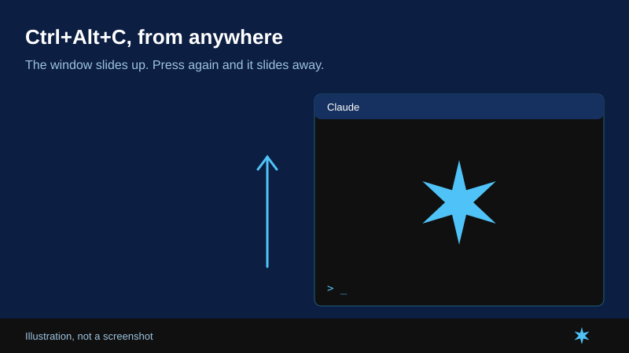

# Claude Code Tray

A drop-down Claude Code window for Windows. Press **Ctrl+Alt+C** anywhere and the terminal slides up from the taskbar. Press it again and it slides away, with the session still running.

[Русская версия](README.ru.md)

**Install:** download the repository and double-click `install.cmd`. That's it.

## Features

- **Toggle window:** Ctrl+Alt+C or a click on the tray icon.
- **Voice typing:** Ctrl+Alt+V opens the window and starts Windows voice typing (Win+H). It listens in the language of your current keyboard layout.
- **Smooth animation:** a slide and a star, in step with your screen's refresh rate.
- **Reminders:** repeats a sound while Claude is waiting and the window is hidden (optional, see below).
- **Small footprint:** one C# file, no dependencies.

## Requirements

- Windows 11 (the only version tested)
- [Windows Terminal](https://aka.ms/terminal) (setup installs it if missing)
- Claude Code, from the native installer or on your PATH

## Install

Download the repository and double-click **install.cmd**. It's safe to run again. Setup:

1. Checks for Claude Code and Windows Terminal, and installs the terminal with winget if needed.
2. Builds the tray with the C# compiler included in Windows and puts it in `%LOCALAPPDATA%\ClaudeCodeTray`.
3. Copies the sounds to `~/.claude/sounds`, keeping any files already there.
4. Adds hooks to `~/.claude/settings.json`, keeping your other settings. The original is saved once as `settings.json.before-tray`.
5. Turns on autostart and starts the tray.

Restart open Claude Code sessions to turn on the sounds.

To remove the tray, its autostart and its hooks, run `install.cmd -Uninstall`. The sound files stay.

## Reminder sounds

A sound plays when a response finishes (`coin-quiet.wav`) and when Claude needs you (`notify-quiet.wav`). If the window stays hidden, the tray repeats it once a minute, up to 30 times.

## Good to know

- New sessions start in your user folder.
- The voice panel is closed by clicking its X, because Windows offers no safe API for it. The mouse moves there for a moment.

## License

[MIT](LICENSE)
